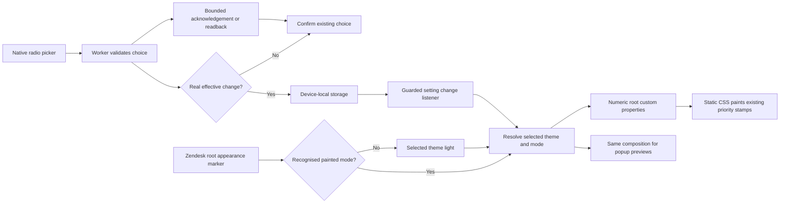

# Phase 08: Themes That Follow Dark Mode — Research

**Researched:** 2026-10-08
**Domain:** No-build MV3 extension palettes, host appearance, accessible popup settings
**Confidence:** MEDIUM — direct source inspection and reproducible numerical experiments; final Chrome paint and human acceptance remain unobserved.

<user_constraints>
## User Constraints (from CONTEXT.md)

The following decisions, discretion and deferred scope are copied verbatim from 08-CONTEXT.md. DATA_8D14B30F_START

### Locked Decisions

### Carried forward — not reopened
- **D-01:** Classic is the default. Its light-mode tints remain identical to 0.1.0. Classic dark keeps the same priority hues with strengths tuned for dark mode. A fresh install or unchanged upgrade stores nothing beyond the existing `enabled` preference.
- **D-02:** Every preset exposes red, orange, yellow, green, cyan, blue, purple and magenta in both light and dark variants, plus a four-priority mapping. Resolve colours in JavaScript and emit numeric CSS custom properties with 0.1.0 literal fallbacks. Theme and appearance changes update document-level properties without re-evaluating rows.
- **D-03:** Follow Zendesk's painted mode from the observed `html[data-theme]` marker. Recon found an in-place marker change on Light/Dark switches and stale-until-reload Match system behaviour after an OS toggle. The OS preference is never the source of truth. An absent or unrecognised Zendesk mode uses the light variant of the selected theme (DARK-05), not a different preset. Keep the host's native hover, selection, focus and sticky-header paint intact.
- **D-04:** Keep `storage` as the only permission, the existing Zendesk agent match pattern, Chrome minimum 106, no runtime dependencies, no build step, no telemetry and no runtime network calls. Settings remain device-local. The existing switch, toolbar diagnoses and English-only supported-view boundary remain intact.
- **D-05:** Extend the existing `theme` registry entry and worker settings queue. Preserve the stored `{ v: 1, id: 'zhroma-classic' }` shape and Classic ID; additional stable IDs are implementation discretion. Absent settings mean defaults. Unreadable values are never deleted, repaired or rewritten automatically. Writes occur only for a real user change; returning from another preset to Classic stores an explicit choice. Re-selecting the effective theme writes nothing, including an unreadable setting currently falling back to Classic.

### Picker layout and interaction
- **D-06:** Use one compact, vertically scrollable list of labelled theme choices in the popup. Keep the existing enable switch and view status above it. Put Classic first, then the named presets in requirement order, then the colourblind-safe preset. Show a clear selected indicator independent of colour. No search, categories or separate selection dialog are needed for eight choices.
- **D-07:** Each choice shows two labelled previews, Light and Dark, side by side. Each preview contains all four actual composited priority tints on the measured Zendesk surface, in Urgent/High/Normal/Low order. Use the same palette resolution and composition path as the runtime and validator; raw upstream swatches are insufficient. Explain the priority order once. Selection works by keyboard and has a visible focus indicator.
- **D-08:** Selecting a preset saves and applies it immediately; no Apply button, hover-to-apply or unsaved preview mode. A saved global theme reaches all open supported Zendesk views through the existing settings path. The picker remains usable while tinting is off or no readable view is connected; saving a theme never turns tinting on. Reopening the popup reflects the saved effective choice.

### Priority colour mapping
- **D-09:** Ordinary presets start from the familiar semantic mapping: Urgent red, High orange, Normal yellow, Low green. Preserve that association where readability allows it. Distinguishability, especially Urgent versus High, takes precedence over a rigid mapping: a failing pair may use different slots, with the deviation recorded beside the preset data. Do not silently lower acceptance thresholds to keep the mapping.
- **D-10:** The colourblind-safe preset is exempt from the red/orange/yellow/green convention. Choose its mapping from validation of the final blended colours under deuteranopia and protanopia in both modes, with lightness ordered consistently by priority. Its UI label is “Colourblind-safe”. Do not add a stripe or another treatment in this phase; stripes belong to Phase 9.

### Theme character and tint strength
- **D-11:** Aim for restrained translucent row backgrounds that make priority apparent at a glance. Use source palette hues as the starting point and tune light/dark strengths separately. Prefer an opacity adjustment before altering hues; if that cannot meet readability, use a documented slot remapping or derived colour. Recognisable theme character matters, but readable tickets and distinguishable priorities take precedence over exact upstream colour reproduction. Classic light remains frozen under D-01.
- **D-12:** Ship only presets that pass the required checks on actual blended surfaces in both modes: text contrast at least 4.5:1, priority separation, distinction from untinted rows, and preservation of native states. Research selects and justifies the numerical distinguishability thresholds, baseline treatment and simulation tooling; no invented thresholds or swatch-only evidence. A failed optional branded preset is omitted with a recorded reason. Classic and the required colourblind-safe capability must be made to pass rather than silently dropped.
- **D-13:** Credit every bundled preset's source, licence and any derivations in the shipped source/package. Use descriptive theme names without logos or implied endorsement. Research must verify current primary source and licence evidence and record the Gruvbox decision. Prefer a clearly licensed source; do not treat ambiguous permission as settled by this delegation. Exact attribution presentation and suitable source variants are implementation discretion.

### Fallback and save failures
- **D-14:** A saved theme that cannot be read or validated falls back to Classic, with a separate theme message: “Your saved theme could not be read. Using Classic.” Keep tinting available under the existing enable setting. Do not replace the Priority diagnosis or turn an unreadable theme into a view error. A missing key is normal and shows no warning.
- **D-15:** Show the last confirmed effective choice while a save is pending; prevent overlapping saves. A confirmed failure shows “Theme could not be saved. Try again.” and retains the confirmed choice. If the outcome is unknown, re-read the setting and report “Theme could not be confirmed” until resolved; never assert that no write occurred when it might have landed. No silent background retries or automatic repair.
- **D-16:** A saved choice and a view application are different facts. Do not display “applied” unless the implementation has evidence for it. No connected view is a normal configuration case: retain the existing connection status and allow saving. If an actual application failure is detected, report it separately without presenting the setting as unsaved.

### Agent's Discretion
- Exact popup dimensions, preview geometry, selection controls, copy refinements and attribution placement within D-06–08 and D-13–16.
- Source variants, derived slots and light/dark opacity values within D-09–13; record the rationale and validator results.
- Detector observer scope, module layout, bounded message protocol, readback details and stale-reply handling. These are research/planning choices, not questions for the user.
- Test tooling selection and numerical validator thresholds need research. This discussion does not approve installation of any new dependency or an exact version; follow the existing approval process if one is needed.
- Keep verification proportionate: automated palette/parity checks and Phase 8 dev-byte dark row-state checks; the full regression and release-candidate UAT remains in Phase 11. Preserve the existing one-round review/repair cap and separately report any remaining blockers.

### Deferred Ideas (OUT OF SCOPE)

None added by the user. Preserve existing later-phase work: rules and stripes (Phase 9), editor/identity/settings files (Phase 10), public release and final regression UAT (Phase 11). Custom theme editing remains THEME-F1.

DATA_8D14B30F_END
</user_constraints>

## Project Constraints (project instructions)

No project AGENTS.md or project-local skill was found in the inspected locations; the user-supplied AGENTS instructions govern reasoning and communication. Explain mechanisms, distinguish inference from observed facts, preserve unrelated edits and evidence states. [VERIFIED: research-session instruction/discovery]

The generated `.claude/CLAUDE.md` contains historical v1 advice as well as current constraints. Follow MV3, Chrome-only, narrow host scope, zero setup, local privacy, authored unbundled source and no runtime dependencies/network. Its old suggestions to omit the worker/storage and minimum Chrome version are superseded by the actual Phase 7 contracts and Phase 8 D-04; do not resurrect them. [VERIFIED: .claude/CLAUDE.md:11-18,73-91,255-290; 08-CONTEXT.md:25]

## Summary

Use a small shared numerical colour module and frozen theme data, a root-only appearance observer, the existing settings queue, and a native radio picker. Palette changes update only custom properties: the table controller still discovers and stamps priority exactly as before. This recommendation follows the existing separation between settings changes and row reconciliation. [VERIFIED: extension/content.js:545-558; 08-CONTEXT.md:23,109-111]

The measured baseline is an essential exception: immutable Classic light has a closest pair below the CSS Color working draft's approximate just-noticeable-difference example. Freeze the baseline's individual pair/state floors, while new palettes use a stronger project threshold. These are engineering acceptance policies supported by calculations, not universal claims about human scanning performance. [CITED: https://www.w3.org/TR/2026/CRD-css-color-4-20261007/#deltaEOK; VERIFIED: numerical experiment below]

**Primary recommendation:** implement the colour validator and Classic compatibility path before authoring presets; ship only the validated registry. No new package is required. [VERIFIED: 08-CONTEXT.md:38-39,51]

## Architectural Responsibility Map

| Capability | Primary tier | Secondary tier | Recommended ownership |
|---|---|---|---|
| Read painted appearance | Browser content script | — | Exact root marker; no OS inference |
| Resolve slots and compose preview colours | Pure shared browser code | Developer validator | Same numerical inputs, deterministic functions |
| Paint existing rows | Static content CSS | Root custom-property writer | Keep priority stamps and selector boundary |
| Validate/save theme | Extension worker | Pure registry | Reuse bounded single writer |
| Persistent choice | Device-local Chrome storage | Worker readback | No seeds/migrations on install |
| Accessible selection | Extension popup | Worker | Confirmed choice and independent theme messages |

This is a prescriptive design derived from D-02–08 and the source seams, not a claim that the new modules already exist. [VERIFIED: 08-CONTEXT.md:22-31]

<phase_requirements>
## Phase Requirements

Descriptions below are copied from REQUIREMENTS.md; implementation support is this research's recommendation. [VERIFIED: .planning/REQUIREMENTS.md:31-45]

| ID | Description | Research support |
|---|---|---|
| DARK-01 | Tints follow the agent's Zendesk appearance setting (Light, Dark, Match system), not the operating-system setting on its own | Root-marker detector; stale Match-system fixture |
| DARK-02 | When the agent switches Zendesk between light and dark mid-session, tints switch to the matching variant without a reload | Filtered observer; properties only |
| DARK-03 | In dark mode, the four priority tints stay distinguishable from each other and from untinted rows, and ticket text stays readable (contrast ≥ 4.5:1) | State-aware colour gate |
| DARK-04 | Zendesk's native hover, selection and focus states stay visible on tinted rows in dark mode | Composition, untouched state styling, dev-byte check |
| DARK-05 | When Zendesk's mode cannot be determined, Zhroma uses the light variant (0.1.0 behaviour) | Selected-theme light fallback |
| THEME-01 | Agent can choose a theme in the popup, and the open view re-colours immediately without a reload | Worker queue → existing change listener |
| THEME-02 | Presets are Classic (default; 0.1.0's colours in light mode), Catppuccin, Tokyo Night, Dracula, Nord, Gruvbox, Solarized and a colourblind-safe preset; a preset that fails the readability check does not ship | Source pins; tune then accept/omit |
| THEME-03 | Every theme provides the same eight named colour slots (red, orange, yellow, green, cyan, blue, purple, magenta) in light and dark variants, and maps the four priorities onto slots | Exact slot schema and mapping gate |
| THEME-04 | The colourblind-safe preset keeps the four priorities distinguishable under simulated deuteranopia and protanopia in both modes, with lightness ordered by priority | Machado severity 1.0, ordered distance from surface |
| THEME-05 | The theme picker shows each theme's actual rendered tints, with the light and dark versions side by side | Shared source-over composition |
| THEME-06 | The chosen theme persists across browser restarts | Worker/storage/reopened-world tests |
| THEME-07 | Every bundled theme credits its source and licence, and the Gruvbox licence decision is recorded | Pinned notices and source decision below |
</phase_requirements>

## Standard Stack

| Tool | Version/state | Use |
|---|---|---|
| Browser JavaScript, CSS custom properties, MutationObserver | Existing Chrome floor | Runtime; authored classic scripts |
| Vitest | `"vitest": "4.1.11"` | Existing actual-source and numerical tests |
| happy-dom | `"happy-dom": "20.13.1"` | Existing DOM/messaging fixtures |
| TypeScript | `"typescript": "7.0.2"` | Existing no-emit checker |
| Chrome types | `"@types/chrome": "0.3.0"` | Existing API declarations |

The package declarations are verbatim installed-project pins, not latest-registry recommendations. Actual installed tools returned Vitest 4.1.11, TypeScript 7.0.2 and happy-dom 20.13.1 during research. [VERIFIED: package.json:15-19; research-session version probes]

**Installation:** none. Do not install a colour library, browser automation package or palette package for this phase. Fixed model matrices, small pure arithmetic and golden vectors are sufficient for the recommended checks. A future decision to add a dev oracle needs a registry/legitimacy/postinstall audit and separate exact-version user approval under the existing approval record; the sensible-default delegation does not supply that approval. [VERIFIED: 08-CONTEXT.md:51; DEPENDENCY-APPROVALS.md:exact-version attestations; 07-CONTEXT.md:125-129]

## Package Legitimacy Audit

Not applicable: this research recommends no external package installation. Existing approved pins remain unchanged. No npm package was fetched or executed. [VERIFIED: research-session action record]

## Architecture Patterns



### Component responsibilities and loading

Proposed new flat files: `extension/zhroma-colour.js` for finite RGB/alpha parsing, numeric emission, composition and colour maths; `extension/zhroma-themes.js` for frozen data and attribution. These names are design recommendations, not existing filesystem paths. Keep simulation matrices and validation reports in developer tests rather than shipped runtime code. [VERIFIED: 08-CONTEXT.md:23,25,50-51]

Load shared numerical/palette data before settings in the manifest, worker and popup wherever consumed. The settings enum should derive from the accepted theme registry or have one agreement test against it, preventing a stored ID that paints no palette. The worker only needs ID validation; it must not depend on document APIs. Include every new packaged file in the explicit inventory and restate versioned inventory pins in a separate contract commit. [VERIFIED: extension/manifest.json:17-23, quoting `"js": ["zhroma-settings.js", "content.js"]`; scripts/release-source.js:27-50, quoting `'zhroma-settings.js', 'zhroma.css'`; 07-CONTEXT.md:56]

The tracer content loader already follows manifest order, but its popup loader directly executes only one script. Update that seam to read packaged popup script order when the popup gains shared dependencies; otherwise tests can accidentally omit production modules. Keep denied network/storage channels intact. [VERIFIED: test/extension/tracer-world.js:668-686,728-740, quoting `new Script(asset('popup.js'), { filename: 'popup.js' }).runInContext(context)`]

### Appearance lifecycle

Use an independent observer on the document root with attributes enabled and a filter containing only the observed appearance marker. Read the marker before tinting starts, on its changes, and when restoring from pagehide/bfcache. A present recognised dark value selects dark; every other value selects the current theme's light variant. Do not observe root style, body subtrees or CSSOM rules for this detector. Document-property writes then cannot trigger its own observer. [VERIFIED: SELECTORS.md:301-324, quoting `html data-theme dark` and `html data-theme light`; CITED: https://developer.mozilla.org/en-US/docs/Web/API/MutationObserver/observe]

When suspended, disconnect the appearance observer and resynchronise on restoration; when simply hidden, either retain this root-only observer or re-read on visibility return. Both must preserve the existing preference readiness and paused tint controller. Deduplicate effective theme/mode before writing properties. Never call table reconcile for a palette-only change. [VERIFIED: extension/content.js:421-439, quoting `readSettings()`; 08-CONTEXT.md:23]

### Settings, fallback and confirmed state

The existing registry's source-of-truth values are DATA_A109D842_START `['default', 'stored', 'unreadable']`, `['zhroma-classic']`, `key: 'theme'`, `version: 1`, `cas: false`, `maxBytes: 128`, `defaultValue: 'zhroma-classic'` DATA_A109D842_END. Preserve the envelope and cap. New stable IDs can be named consistently during implementation and must fit the cap. [VERIFIED: extension/zhroma-settings.js:146-149,423-435]

**Required D-05 correction:** the queue currently excludes unreadable fallback values from its no-op guard: DATA_930F181A_START `if (current.status !== 'unreadable' && registry.equal(key, current.value, value)) { answer(job, 'unchanged'); return; }` DATA_930F181A_END. Thus reselecting effective Classic over corrupt storage can overwrite that storage. Add a narrowly scoped theme effective-value comparison after request validation and successful read, allowing unchanged without repairing corrupt storage. Test a malicious direct worker request as well as the picker no-op; the UI guard alone is insufficient. Do not broaden this into unrelated CAS repairs. [VERIFIED: extension/zhroma-settings.js:523-530]

Add a small worker-only theme read message with exact request/reply schemas and existing packaged-page sender checks; the popup never reads storage directly. Keep theme choice, pending request owner and last confirmed selection separate from the enable switch. Disable overlapping theme saves, restore the confirmed radio before awaiting, then update it only on valid acknowledgement/readback. A transport timeout after a write may have been issued is unknown. Re-read once with a bounded deadline; if it stays unreadable/unavailable, retain the theme-specific unknown message and retry only through explicit user action or popup reopening. [VERIFIED: extension/popup.js:53-57,113-129,160-188; extension/background.js:424-465,496-538; 08-CONTEXT.md:44]

Use the existing settings write outcomes verbatim DATA_01CEB910_START `'saved'`, `'unchanged'`, `'failed'`, `'rejected'`, `'unknown'` DATA_01CEB910_END, with runtime schema checks and stale request ownership. A persisted choice reaching storage is not proof that an open view painted it. Keep existing connection/priority status separate; the recommended initial picker says which choice is saved and does not advertise an applied success. If an application acknowledgement is introduced, bind it to the current document and expected theme/mode and report actual failures separately. Do not copy the known enable handshake's accepted false-positive semantics into a new theme handshake. [VERIFIED: extension/zhroma-settings.js:517-536,568-587; 08-CONTEXT.md:45; 07-REVIEW-DISPOSITION.md:59-60, quoting `WR-02` / `skipped`]

### Popup accessibility

Use a native fieldset/legend and radios, visible labels, a non-colour checked indicator and visible focus outline. Give preview strips Light/Dark labels and explain the Urgent/High/Normal/Low order once; mark decorative swatches hidden from accessibility APIs to avoid redundant announcements. Place a separate finite theme status region after the picker, preserving the existing priority live region. Start around 22rem wide with a bounded scrolling list, then verify zoom and keyboard reachability in Chrome; exact geometry remains delegated design. [VERIFIED: 08-CONTEXT.md:29-31,43-45,48]

## Numerical Validation and Frozen Baseline

### Model and inputs

Compose encoded sRGB channels using source-over on the opaque measured pane. Native row paint is the first layer; Zhroma's translucent cell is the second: `cell = alpha*tint + (1-alpha)*(nativeAlpha*nativeRGB + (1-nativeAlpha)*pane)`. Do not blend in linear light and call it the current CSS output. Linearise the final encoded RGB only for luminance, Oklab and CVD calculations. A browser test must independently confirm this model against emitted CSS because happy-dom computed RGBA is not a flattened screenshot. [CITED: https://www.w3.org/TR/compositing-1/#simplealphacompositing; VERIFIED: SELECTORS.md:169-176,338]

Recorded inputs, quoted verbatim: DATA_F184E1A9_START light `rgb(255, 255, 255)` with text `rgb(41, 50, 57)`; dark `rgb(21, 26, 30)` with text `rgb(216, 220, 222)`; light hover `rgba(31, 115, 183, 0.08)`, selected `rgba(31, 115, 183, 0.16)`; dark hover `rgba(102, 160, 205, 0.08)`, selected `rgba(102, 160, 205, 0.16)` DATA_F184E1A9_END. These are existing ledger observations, not fresh live measurements in this research. [VERIFIED: SELECTORS.md:169-176,301,338]

Pinned baseline revision is DATA_97F1C0A2_START `6d3ab0b10e9419a5c1077e59e468977c00d59d4a` DATA_97F1C0A2_END. The calculation read it through the baseline reader, which verifies candidate identity and each blob hash; it did not take baseline colour values from the working tree. Literal Classic values are DATA_4ABDF216_START `rgb(220 38 38 / 0.14)`, `rgb(234 88 12 / 0.12)`, `rgb(202 138 4 / 0.09)`, `rgb(22 163 74 / 0.08)` DATA_4ABDF216_END. Keep these exact CSS fallbacks and resolved Classic-light values. [VERIFIED: scripts/baseline-source.js:39-44,120-159; extension/zhroma.css:1-27]

### Calculated baseline evidence

All distances below mean **100 × Euclidean distance in original Oklab**, not CIEDE2000 or a newer Oklab variant. Contrast uses actual text/pixel colours. Numbers are displayed rounded; compare full precision in tests. The research scratch program used Ottosson's published 2021 matrices and the WCAG sRGB transfer/luminance equations. [CITED: https://bottosson.github.io/posts/oklab/; https://www.w3.org/TR/2026/CRD-css-color-4-20261007/#deltaEOK; https://www.w3.org/WAI/WCAG22/Understanding/contrast-minimum.html; VERIFIED: research-session calculation]

| Baseline treatment | State | Minimum priority pair | Minimum tint/untinted | Minimum text contrast |
|---|---|---:|---:|---:|
| Classic light | normal | 1.93536053 | 3.47428683 | 10.48743595 |
| Classic light | hover | 1.94263387 | 3.28410435 | 9.48724908 |
| Classic light | selected | 1.94616871 | 3.06081581 | 8.55213991 |
| Old light alphas on dark, diagnostic only | normal | 1.96806844 | 3.98434213 | 11.20279942 |
| Old light alphas on dark, diagnostic only | hover | 1.83974043 | 3.54264112 | 9.98845655 |
| Old light alphas on dark, diagnostic only | selected | 1.74679462 | 3.15777943 | 8.74024895 |

These are computed outputs, not dark-mode acceptance of the old build. [VERIFIED: pinned-baseline numerical experiment]

Freeze **each pair**, not just the aggregate minimum. Pair order is Urgent/High, Urgent/Normal, Urgent/Low, High/Normal, High/Low, Normal/Low. [VERIFIED: extension/zhroma.css:3-26, quoting `"Urgent"`, `"High"`, `"Normal"`, `"Low"`; numerical experiment]

| Classic light state | Six pair floors (ΔEOK ×100) |
|---|---|
| normal | 2.66319365, 4.85223756, 5.61257702, 2.27200203, 3.51207582, 1.93536053 |
| hover | 2.62903685, 4.75894021, 5.54625752, 2.21914721, 3.49810973, 1.94263387 |
| selected | 2.59553557, 4.66767150, 5.48137361, 2.16809714, 3.48365204, 1.94616871 |

Baseline normal composites in the same priority order: `(250.1,224.62,224.62)`, `(252.48,234.96,225.84)`, `(250.23,244.47,232.41)`, `(236.36,247.64,240.52)`. [VERIFIED: pinned-baseline numerical experiment]

### Selected project acceptance policy

These thresholds are delegated project decisions justified by the cited model and the above calculations. They are **not established universal perceptual standards**. [VERIFIED: 08-CONTEXT.md:39,51]

| Check | Gate |
|---|---|
| Actual text | Contrast ≥4.5:1 on normal, hover and selected composites in both modes |
| Newly authored priority separation | Every one of six pairs ≥3.0 ΔEOK×100, including Urgent/High; all three native states |
| Newly authored tint/untinted separation | Each priority ≥2.0 against the same-state untinted composite |
| Classic light compatibility exception | Literal RGBA equality plus no regression in any frozen pair/state or tint/untinted floor above; allow numerical tolerance 1e-6 only |
| Colourblind-safe | Same ≥3.0 pair and ≥2.0 untinted checks after severity-1 protanopia and deuteranopia, in both modes/states |
| CVD priority lightness order | Urgent→High→Normal→Low gets progressively closer to the untinted surface: increasing Oklab L in light, decreasing L in dark; strictly ordered under normal and both simulations |
| Native row paint | Normal→hover and hover→selected remain ≥2.0 ΔEOK×100 on every tinted priority; native indicator styling remains unchanged |

Rationale: the CSS Color draft uses 0.02 original Oklab distance as a JND reference in gamut mapping, or 2 on this report's scale. A 3.0 pair threshold gives a 50% numerical margin above that reference and exceeds the frozen weakest pair. A 2.0 tint/native threshold is a visibility screen, not proof of at-a-glance usability; increasing it should follow the dev-byte checks, not an unsupported appeal to a universal standard. Classic's pre-existing weakest pair is explicitly grandfathered because D-01 forbids changing it; no new preset inherits that exception. [CITED: https://www.w3.org/TR/2026/CRD-css-color-4-20261007/#chroma-reduction; VERIFIED: experiment and 08-CONTEXT.md:22]

Check real link, muted and secondary text colours if the dev view contains them: the ledger's one cell-text value cannot establish their contrast. Record a failure or additional measured input instead of claiming every text style passed. [VERIFIED: SELECTORS.md:301,338 — recorded values quoted above; recommendation]

### Feasibility experiments, not shipped palette approval

Keeping all four Classic source RGB values and setting **dark alpha 0.30** produced minima of pair **4.72941628**, untinted **10.33193452**, contrast **6.31359161** across the three states. Native normal→hover/hover→selected minima were **2.40821953/2.45936366**. Use this as the initial Classic-dark candidate, then verify actual Chrome and dev-byte native states. [VERIFIED: numerical experiment]

A feasibility-only CVD prototype used Okabe–Ito-style seed accents with these per-priority inputs:

| Mode | Urgent | High | Normal | Low |
|---|---|---|---|---|
| light | #0072b2 / .42 | #cc79a7 / .29 | #e69f00 / .20 | #009e73 / .08 |
| dark | #e69f00 / .39 | #56b4e9 / .27 | #cc79a7 / .20 | #0072b2 / .14 |

Across normal, protan and deutan simulation and all three native states it produced minimum pair **3.24467393**, minimum untinted **2.35287561**, actual contrast **4.77198927**, with the required lightness order. Actual native-transition minima were light **2.22930715/2.22513725**, dark **2.05622479/2.05760038**. This demonstrates numerical feasibility; its dark selected contrast has limited margin and is a useful early dev-byte stress case. [VERIFIED: numerical experiment]

**Source decision (A1 RESOLVED):** independently author the Colourblind-safe data as project-owned contributions; no third-party palette licence applies, and no repository-wide licence is invented. Generate candidates by a reproducible numerical search over RGB channels, alpha and priority-slot constraints, using the measured surfaces and the frozen acceptance gates above. Record search bounds, deterministic seed/tie-breaks, resulting values and gate reports beside the final data. This is a delegated source/design choice, not a claim that final data already exists or passes. [VERIFIED: 08-CONTEXT.md:47-52; project design decision]

The Okabe–Ito-style prototype above is **historical feasibility evidence only**. Do not copy its palette values, use them as search seeds or ship them as Zhroma-authored source data; start the independent search from RGB-space constraints rather than that named palette. Its unresolved reuse terms therefore create no dependency for the selected source strategy. No dependency installation or new third-party palette is required. [VERIFIED: prototype input record; project design decision]

### CVD method and golden tests

Use the Machado, Oliveira & Fernandes 2009 published matrices at severity **1.0**. The author's supplement describes 1.0 as dichromacy and 0.0 as absence of CVD. The research fetched the primary page successfully through a read-only network probe after browser-fetch timeouts; its SHA256 was `379c549025f91ac05a611631114ff8202fa2d802bc29e15f79479c7985373346`. [VERIFIED: https://www.inf.ufrgs.br/~oliveira/pubs_files/CVD_Simulation/CVD_Simulation.html]

```text
protanopia:
  0.152286  1.052583 -0.204868
  0.114503  0.786281  0.099216
 -0.003882 -0.048116  1.051998
deuteranopia:
  0.367322  0.860646 -0.227968
  0.280085  0.672501  0.047413
 -0.011820  0.042940  0.968881
```

These are the primary supplement's numerical values, read this session. **Simulation decision (A2 RESOLVED):** final composited encoded sRGB → decode to linear sRGB → severity-1 matrix → clamp linear channels to [0,1] → encode sRGB → Oklab. Retain the existing Oklab and sRGB transfer equations cited above; avoid applying the matrix directly to gamma-encoded channels. [VERIFIED: primary supplement severity-1 table; project design decision]

For normalized nonnegative encoded channel `c`, use W3C's exact sRGB decoding recipe: `c <= 0.04045 ? c / 12.92 : ((c + 0.055) / 1.055) ** 2.4`. After matrix application and clipping, encode linear channel `x` with `x <= 0.0031308 ? 12.92 * x : 1.055 * x ** (1 / 2.4) - 0.055`. These are the application transfer functions, separate from Machado's physiological matrix. [CITED: https://www.w3.org/TR/2026/CRD-css-color-4-20261007/#color-conversion-code]

The corrected original paper was inspected directly: §4.1, PDF page 4, Eq.8 projects RGB primary **spectral power distributions** onto opponent basis functions; Eqs.10–11 define and compose the resulting linear transformation. §4.3, PDF page 6, Eq.24 gives the final simulation operator. Consequently its RGB coefficients multiply linear primary-light contributions: a nonlinear encoded channel is not proportional to the spectral power used by Eq.8. This is a mathematical inference from the published physical construction, **not** a quotation asserting that the paper contains an explicit sRGB gamma recipe. The project selects the sRGB transfer function for its CSS/browser inputs. [VERIFIED: corrected paper §4.1 Eqs.8–11 and §4.3 Eq.24; inference from those equations; CITED: https://profs.ic.uff.br/~laffernandes/content/publications/journal/2009_tvcg_15%286%29/machado_oliveira_fernandes-tvcg-15%286%29-2009-corrected.pdf]

The paper's §5.1, PDF page 6, Gamma 2.2 statement describes monitor calibration for its human experiment; it is not the browser transfer function or an instruction to transform encoded CSS values directly. Gamut clipping above is the project's explicit display policy after simulation. Author the numerical implementation locally from these equations and attributed matrix coefficients; do not import a third-party simulator implementation or require an external package. Golden vectors test that chosen pipeline; actual Chrome composition and human recognisability remain execution checks. [VERIFIED: corrected paper §5.1; project design decision]

Golden calculated vectors for original matrices: encoded red `(255,0,0)` gives Oklab `(0.6279553606,0.2248630611,0.1258462985)`, simulated protan RGB `(108.78516029,95.02684074,0)` and deutan `(163.21518658,144.28077001,0)`. Also test identity at severity 0, black/white invariance within matrix rounding tolerance, alpha 0/1 composition, 21:1 black/white contrast, reversed layer order, and deliberately identical priority colours failing the validator. Do not make the validator test merely recompute expected values through its own functions. [CITED: https://bottosson.github.io/posts/oklab/; VERIFIED: numerical experiment]

## Source and Licence Custody

The following primary repository commits and raw licence/palette files were fetched read-only during research. Commit dates describe those snapshots, not a guarantee that a theme is maintained or ready to ship. [VERIFIED: GitHub primary commit/raw-file probes, 2026-10-08]

| Preset | Pinned primary source | Licence evidence | Recommended variants/derivations |
|---|---|---|---|
| Catppuccin | [d09787dd98ca6fba08af5ef2ae94a7e09f17daca](https://github.com/catppuccin/catppuccin/tree/d09787dd98ca6fba08af5ef2ae94a7e09f17daca), 2026-07-25; README palette | [MIT LICENSE](https://github.com/catppuccin/catppuccin/blob/d09787dd98ca6fba08af5ef2ae94a7e09f17daca/LICENSE), Catppuccin 2021 | Latte/Mocha; map peach→orange and mauve→purple |
| Tokyo Night | [7c0f11eaef322f293621ca7befe462214b7ea468](https://github.com/enkia/tokyo-night-vscode-theme/tree/7c0f11eaef322f293621ca7befe462214b7ea468), 2025-02-05; README palette | [MIT LICENSE.txt](https://github.com/enkia/tokyo-night-vscode-theme/blob/7c0f11eaef322f293621ca7befe462214b7ea468/LICENSE.txt), Enkia 2018-present | Light/Night; separately derive magenta if sharing purple fails slot character |
| Dracula | [e22ebcc048b8aff586f9bc94db30ff5347070b42](https://github.com/dracula/dracula-theme/tree/e22ebcc048b8aff586f9bc94db30ff5347070b42), 2026-10-01; README OSS palette | [MIT LICENSE](https://github.com/dracula/dracula-theme/blob/e22ebcc048b8aff586f9bc94db30ff5347070b42/LICENSE), Dracula Theme 2023 | Alucard/Dracula; derive missing blue and record the derivation |
| Nord | [1cef71605416a222e57225b544540ce0fcec18d4](https://github.com/nordtheme/nord/tree/1cef71605416a222e57225b544540ce0fcec18d4), 2023-05-03; src/nord.css | [MIT license](https://github.com/nordtheme/nord/blob/1cef71605416a222e57225b544540ce0fcec18d4/license), Sven Greb 2016-present | Adapt the supplied accents to measured light/dark surfaces; label derived slots |
| Gruvbox | [154eb5ff5b96d0641307113fa385eaf0d36d9796](https://github.com/ellisonleao/gruvbox.nvim/tree/154eb5ff5b96d0641307113fa385eaf0d36d9796), 2026-04-15; lua/gruvbox.lua | [full MIT LICENSE](https://github.com/ellisonleao/gruvbox.nvim/blob/154eb5ff5b96d0641307113fa385eaf0d36d9796/LICENSE), NpX 2021 | Use faded/bright accents from this source; acknowledge original morhetz lineage; derive eighth magenta slot if needed |
| Solarized | [62f656a02f93c5190a8753159e34b385588d5ff3](https://github.com/altercation/solarized/tree/62f656a02f93c5190a8753159e34b385588d5ff3), 2018-04-02; README palette | [MIT-style LICENSE](https://github.com/altercation/solarized/blob/62f656a02f93c5190a8753159e34b385588d5ff3/LICENSE), Ethan Schoonover 2011 | Same eight accent seeds; tune mode alphas; violet→purple |

**Gruvbox decision:** use the clearly noticed MIT gruvbox.nvim palette source rather than copying the original Vim implementation. The original [morhetz README](https://github.com/morhetz/gruvbox/blob/ef8864bb42bf244f0295d1c5a403b27e3d139695/README.md) explicitly declares MIT/X11; this does not justify claiming GPL restrictions, nor does it settle every absent-notice concern from prior research. The selected port supplies complete notice text beside its palette. Credit both provenance and the selected source; no new ambiguity waiver is inferred. [VERIFIED: primary README and selected port licence/source]

Fetched file SHA256 pairs (palette source; licence), retained here so the planner does not depend on temporary files:

- Catppuccin README `6f5151cdd4fe3e94dac978a9b88444c888698af37ff8e654088cd043d33411b2`; LICENSE `814096d2c34cc216c624738a49356f32b7237733b4f7edb0685f4e50ef5074ba`.
- Tokyo Night README `576b7254966a979d13f4ff0fa13d7e2bebcb36087f1e00b264fa5dc5e4f620cd`; LICENSE.txt `e3f5d0d772cda0f4f67405696f15a0f335460a2b3944eff40f00675aadacb31b`.
- Dracula README `3f798014d8e25a4c15f6ad26bc767d99bfc34b5ce0fe562647d0` is **not** the fetched hash: use exact fetched `3f798014d8e25a4c15f6ad26bc767d99bfc367ec3f9883bd4b5ce0fe562647d0`; LICENSE `38b806a7e799cca4e9821e6f8d65cf0d8bfaaddbe454b41f12e5baad52d310f1`.
- Nord src/nord.css `b931ac3732582b2066b2d6cadec02d9820ba7081e6e3e404c31cb62d9315a962`; license `25ac8188d670bd2ad2ce2f4f55ab88573010ee9f7a4502543cb1eea1e2274f8a`.
- Gruvbox port lua/gruvbox.lua `305e6750f877f582c37a20bb9db1528be95da154815a31ac676142f64fa82690`; LICENSE `40f9e21e8e8bd3e740665c27945b6d6bf8afbc8008439aa749cb477157390524`.
- Solarized README `f10571c994648365faab9c4f83bdd7699aa2cd056f111af5e29099c2673c5bc1`; LICENSE `494aefdabf86acce06bd63001ad8aedad4ee38da23509d3f917d95aa3368b9a6`.

[VERIFIED: research-session fetched-byte SHA256 index]

Preserve full notices in shipped palette comments or a packaged notices file, not merely a repository-only link. Record source variant, each derived slot, priority remapping, alpha values and validator results beside final data. All six branded sources are candidates, not accepted palettes: implementation must run their final composited gate and record omissions instead of weakening it. [CITED: pinned MIT notices above; VERIFIED: 08-CONTEXT.md:34-40]

## Don't Hand-Roll

| Problem | Use instead |
|---|---|
| Appearance inference | Observed root marker, not brightness guesses or OS listeners |
| Preference persistence/races | Existing validated worker queue and generation guards |
| Radio navigation | Native radio group and focus behaviour |
| Colour science | Published fixed equations/matrices, small local arithmetic, independent golden vectors |
| Preview palette | Same resolved/composited data, not duplicated CSS swatches |
| Baseline identity | Existing pinned Git reader, not a copied working-tree constant |

These choices reuse the source-owned mechanisms inspected above. [VERIFIED: canonical source seams and 08-CONTEXT.md:23-31]

## Common Pitfalls

- **A universal ≥2 gate rejects frozen Classic light.** Use the explicit immutable exception and full per-pair floors; all newly authored priorities use ≥3. [VERIFIED: baseline calculation]
- **Raw swatches pass while row fills collapse.** Validate after both native and tint layers, then simulate; old Classic dark under deuteranopia fell to minimum pair **0.58675911 normal**, **0.36041146 hover**, **0.21486741 selected** in the experiment. This is not a claim that Classic is CVD-safe. [VERIFIED: numerical experiment]
- **Root style loops and broad observers.** Filter only the observed appearance attribute; theme updates should neither reconcile rows nor flood toolbar messages. [CITED: MDN observe source above; VERIFIED: 08-CONTEXT.md:110]
- **Wrong-mode startup after the bounded settings gate.** Apply default Classic in the actual observed mode before rows paint; later settings resolution changes only properties. A hung read is not proof of key absence. [VERIFIED: extension/content.js:532-540; 07-REVIEW-DISPOSITION.md:30-33, quoting `IN-01` / `open`]
- **Optimistic radio shows an unsaved theme.** Render confirmed state while pending, and treat timeout as potentially landed. [VERIFIED: 08-CONTEXT.md:44]
- **Synthetic DOM proves cascade/native paint.** It cannot establish current Zendesk visual acceptance; separate fixture assertions, actual Chrome composition and a brief dev-byte human check. [VERIFIED: 08-CONTEXT.md:52; parity.test.js:86-93]
- **Third-party notices are only in docs.** Keep credits in actual packaged bytes; frozen-contract remote-URL checks can be sensitive to raw scheme-relative substrings in comments. Use ordinary descriptive HTTPS citations and preserve that gate. [VERIFIED: test/extension/frozen-contract.test.js:19-23; 08-CONTEXT.md:40]

## Test Architecture and Execution Order

Nyquist Validation Architecture is deliberately omitted: configuration explicitly says DATA_D701E883_START `"nyquist_validation": false` DATA_D701E883_END. The tests below are ordinary phase acceptance recommendations, not a new Nyquist workstream. [VERIFIED: .planning/config.json:workflow]

1. **Colour gate first:** proposed numerical test suite with fixed source inputs, frozen baseline floors, matrix/golden vectors, non-finite/out-of-range rejection and known failing pairs. Author final eight-slot records and run all modes/states/CVD combinations. Record each rejected optional preset.
2. **Runtime integration:** actual-source DOM tests for dark startup, marker switches, unknown marker using selected-theme light, theme changes in two content worlds, no added priority reads/stamp churn, off state, stale settings replies, hide/show and bfcache restoration. Preserve selector and language boundaries.
3. **Worker/popup:** corrupt fallback no-op, absent no-op, explicit return to Classic, sender refusal, timeout before versus after issuance, late write/readback, reopen/restart, one save in flight, keyboard radio navigation, visible selected/focus states and separate theme messages.
4. **Contracts and regression:** existing parity, frozen-contract, runtime inventory, upgrade-storage, settings-reader/queue and toolbar-popup tests; typecheck touched shared/runtime files appropriately. Adapt versioned source/inventory pins with an explicit rationale and separate commit; do not weaken frozen tests.
5. **Chrome and brief dev-byte session:** independently compare actual painted normal/hover/selected colours with shared-model values; validate opacity/composition rather than computed RGBA alone. User checks dark native hover, selection indicator, Tab focus and sticky header, plus live Light↔Dark switching and preview appearance. Bind observations to final dev source digest, keep unobserved checks pending. Full release UAT stays Phase 11.

This sequence follows the current harness and delegated proportional verification contract. Existing scripts are DATA_D8A7EE16_START `"typecheck"`, `"test:recon"`, `"test:mutants"` DATA_D8A7EE16_END, with DATA_784CCD39_START `"test": "npm run test:recon"` DATA_784CCD39_END. Run targeted suites during tasks and `env GSD_FIXTURE_MANIFEST=test/fixtures/manifest.json npm test` after integrated changes; retain measured existing mutant kills. Proposed new suite names are planning choices and do not yet exist. [VERIFIED: package.json:9-13; vitest.config.js:3-7; 08-CONTEXT.md:52]

### Outstanding Phase 7 review applicability

| Finding | Present disposition | Phase 8 action |
|---|---|---|
| WR-02 | skipped/user-accepted | Do not use its enable apply acknowledgement as proof of palette application |
| WR-03 | open | CAS/parser equality remains due before Phase 9/10; theme uses primitive IDs. Separate D-05 corrupt-fallback no-op fix is required now |
| WR-04 | open | CAS corrupt revision semantics remain deferred; do not claim theme enum work closes it |
| WR-05 | open | Do not mutate defaults; deep-freeze new palette records. Existing theme default is primitive; retain the generic finding |
| IN-01 | open | Classify new popup read timeout as unknown; preserve current content gate's bounded default semantics |
| IN-02 | open | CAS revision ceiling remains out of this phase |
| IN-03 | open | New theme read handler must reply to its admitted exact shape; invalid/unregistered writes still bounded/refused |
| IN-04 | open | No new dependency introduced; transitive approval history remains unchanged |
| IN-05 | open | Do not refactor test scripts as incidental theme work |

IDs and dispositions are quoted verbatim from the review record; none is asserted repaired. [VERIFIED: 07-REVIEW-DISPOSITION.md:11-49,59-69]

## Runtime State Inventory

This is an additive appearance/settings feature, not a rename or migration. The relevant stored state is the existing device-local theme envelope and separate enable preference; neither is renamed and neither needs an automatic data migration. [VERIFIED: extension/zhroma-settings.js:423-435; 08-CONTEXT.md:25-26]

| Category | Evidence/boundary | Action |
|---|---|---|
| Stored data | Existing theme envelope, absence/corrupt/future-value cases | Read fallback only; explicit user-change writes |
| Live service config | No service configuration change authorised; runtime contacts no remote service | None; no live-service inventory was performed |
| OS-registered state | No OS integration in this feature | None; OS registrations not inventoried |
| Secrets/env vars | Feature requires no credential or new environment key | None; secrets not inspected |
| Build artifacts | Authored extension files and explicit package inventory | Update reviewed inventory for new files; no installed-package migration |

The external-state rows are scope conclusions, not verified absence on every machine. [VERIFIED: phase task boundary and 08-CONTEXT.md:12,25]

## Environment Availability

| Dependency | Research observation | Fallback |
|---|---|---|
| Node | v26.11.0 | Existing local numerical/tool runner |
| npm | 11.20.0 | No install needed |
| Existing test/checker packages | Vitest 4.1.11, happy-dom 20.13.1, TypeScript 7.0.2 present | — |
| Local Chrome | 154.0.8037.98 executable present | Browser run remains implementation work |
| Authenticated Zendesk | Not probed in this research | User-driven dev-byte check later |

These are research-time command observations. Chrome availability proves neither live Zendesk access nor the minimum-106 implementation's final behaviour. [VERIFIED: research-session environment probes]

## Security Domain

Security enforcement is enabled in project configuration. Apply its Level-1 intent to the extension's relevant boundaries, without claiming a full server-application certification. ASVS **5.0.0** changes category numbering; use its names rather than silently labelling the old V2/V3/V4 headings as current. [VERIFIED: .planning/config.json:workflow, quoting `"security_enforcement": true`, `"security_asvs_level": 1`; CITED: https://github.com/OWASP/ASVS/tree/v5.0.0/5.0/en]

| Domain | Applicability/control |
|---|---|
| Encoding and sanitization | Finite numeric CSS output; static labels via textContent; no caller-supplied CSS/HTML |
| Validation/business logic | Exact theme IDs, message schemas, finite RGB/alpha bounds, unknown outcomes/readback |
| Authorization | Packaged-popup/options sender checks; page content cannot write settings |
| Authentication/session management | No new credential/session system; keep host authentication outside the extension |
| Cryptography | No new cryptographic feature; existing source SHA256 remains developer evidence tooling |
| Data protection/configuration | Local-only storage, no runtime network, preserved permission/CSP/source gates |

ASVS source names inform the mapping; specific mitigations are project recommendations grounded in the worker and frozen contracts. [CITED: https://github.com/OWASP/ASVS/blob/v5.0.0/5.0/en/0x10-V1-Encoding-and-Sanitization.md; VERIFIED: extension/background.js:468-538; test/extension/frozen-contract.test.js:3-23]

Main threats are spoofed settings messages (sender allowlist), malformed stored values/CSS injection (shared enum and finite numeric emitter), data exfiltration (frozen network/local-only guards), and misleading success after asynchronous writes (confirmed-state/readback ownership). No ticket text belongs in the palette protocol. [VERIFIED: canonical source seams and 08-CONTEXT.md:25,43-45,104]

## Code Examples

The following is a proposed pure numerical helper, not an existing exported API. Its constants implement the W3C source-over equation and WCAG transfer function. [CITED: W3C compositing and WCAG sources above]

```js
const linear = (encoded) => encoded <= 0.04045
  ? encoded / 12.92 : ((encoded + 0.055) / 1.055) ** 2.4;
const composite = (rgb, alpha, backdrop) =>
  rgb.map((channel, index) => alpha * channel + (1 - alpha) * backdrop[index]);
const luminance = (rgb) => rgb.map(channel => linear(channel / 255))
  .reduce((sum, channel, index) => sum + channel * [0.2126, 0.7152, 0.0722][index], 0);
const contrast = (a, b) =>
  (Math.max(luminance(a), luminance(b)) + 0.05)
  / (Math.min(luminance(a), luminance(b)) + 0.05);
// Compose native row over pane first, then cell tint over that row.
// Convert that final RGB to original Oklab for pair/untinted/state comparisons.
```

## State of the Art

Original Oklab distance is retained deliberately for continuity with baseline research and simple reproducible arithmetic. CSS Color's current draft also documents newer difference variants; do not switch metrics while retaining the old numeric floors. CSS gamut-map JND guidance is a useful reference, not an application usability guarantee. [CITED: https://www.w3.org/TR/2026/CRD-css-color-4-20261007/#color-difference]

Prior architecture's speculative CSS attr-colour, OS-trigger and surface-luminance alternatives are superseded for this phase by JS numeric properties and the observed document marker. The prior summary's Phase 9 dark-detection outline is superseded by the authoritative Phase 8 assignment. [VERIFIED: 08-CONTEXT.md:23-24,76; .planning/ROADMAP.md:134-139]

## Assumptions Log

| # | Disposition | Decision and evidence |
|---|---|---|
| A1 | **RESOLVED — source strategy** | Independently authored project-owned Colourblind-safe data, generated from RGB/alpha/slot constraints; no third-party palette licence applies, and no repository-wide licence is invented. Historical Okabe–Ito-style values are excluded from seeds and shipped inputs. Delegated choice: 08-CONTEXT.md:47-52. Final values and gate reports are execution deliverables. |
| A2 | **RESOLVED — simulation pipeline** | Decode sRGB, apply Machado severity-1 matrix in linear light, clamp, encode, then Oklab. Corrected primary paper §4.1/PDF p.4 Eqs.8–11 and §4.3/PDF p.6 Eq.24 establish a linear spectral-power operator; sRGB decoding is the project's mathematical application of that operator to browser inputs, not an uninspected assumption. |

The project thresholds and candidate geometry are delegated design choices, not assumptions about existing code. Numerical feasibility is distinct from final palette/native-state acceptance. [VERIFIED: 08-CONTEXT.md:47-52; research experiment]

## Open Questions and Evidence Limits

- **No unresolved CVD design-research questions remain:** source strategy and simulation pipeline are selected above. The following final-data, browser and human checks are execution evidence; this revision does not accept any final Colourblind-safe palette or claim fresh human observations. [VERIFIED: research decision/action record]
- Final branded alpha/slot derivations and pass/omit results are implementation work. Exact primary source pins are settled above; eight-slot completion and every final rendered palette remain unvalidated. [VERIFIED: research scope/action record]
- Confirm RGB composition in actual Chrome and all relevant text styles, then the brief dev-byte dark/native session. No fresh live Zendesk observation or human pass was produced here. [VERIFIED: research scope/action record]
- Phase 6 retains its separate verification/custody state: DATA_18D704AE_START `status: gaps_found`, `score: 14/15 must-haves verified` DATA_18D704AE_END; its close-out says DATA_AE760CB1_START `Status: awaiting the private-input location and deletion/encryption outcome` DATA_AE760CB1_END. Six human-verification items remain unaccepted. The `proceed` recon consumer gate does not erase those gaps. Phase 7 remains its recorded passed result. [VERIFIED: 06-VERIFICATION.md:1-5,43-62; 06-CUSTODY-CLOSEOUT.md:4-17; 07-VERIFICATION.md:1-5]
- Keep one review/repair round. If a required capability cannot pass, report that blocker; optional preset omission is allowed, dropping Classic/CVD is not. [VERIFIED: 08-CONTEXT.md:39,52]

## Sources and Metadata

Primary sources: pinned repository/source/licence links above; [W3C compositing](https://www.w3.org/TR/compositing-1/), [CSS Color 4 snapshot](https://www.w3.org/TR/2026/CRD-css-color-4-20261007/), [WCAG contrast](https://www.w3.org/WAI/WCAG22/Understanding/contrast-minimum.html), [Ottosson Oklab](https://bottosson.github.io/posts/oklab/), [Machado author supplement](https://www.inf.ufrgs.br/~oliveira/pubs_files/CVD_Simulation/CVD_Simulation.html), [Chrome storage](https://developer.chrome.com/docs/extensions/reference/api/storage), [MDN observer](https://developer.mozilla.org/en-US/docs/Web/API/MutationObserver/observe), [ASVS 5.0.0](https://github.com/OWASP/ASVS/tree/v5.0.0/5.0/en). Chrome documentation was also queried through Context7 `/websites/developer_chrome_extensions`.

Research-plan seam selected websearch for science/licences and Context7 for Chrome. Confidence seam returned MEDIUM for Context7 and cross-checked websearch, LOW for unverified websearch. Unverified search snippets were not used to settle licences. No cache write occurred because delegated ownership excludes repository research caches. [VERIFIED: research-session seam/tool outputs]

| Area | Confidence | Reason |
|---|---|---|
| Existing stack/settings seams | MEDIUM | Current source opened, installed versions probed; no feature execution |
| Numerical baselines | MEDIUM | Pinned bytes, published equations, actual scratch computation; browser-model cross-check pending |
| Licences/source pins | MEDIUM | Primary licence/palette files and GitHub commit metadata read and hashed |
| Architecture/pitfalls | MEDIUM | Matches locked context/current seams; new code unimplemented |
| Final usability/native paint | LOW | No live or final dev-byte human evidence |

**Research date:** 2026-10-08. Recheck source licences if pin/variant changes; fixed mathematical vectors remain reproducible. Review host observations when new dev-byte evidence differs. Research output is intentionally uncommitted under the orchestrator's ownership instruction.
